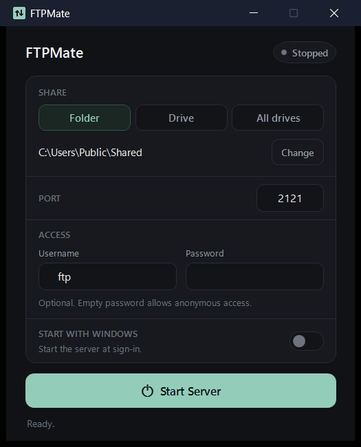

# FTPMate

A lightweight FTP server for Windows with a clean, focused interface.


FTPMate exposes a folder, a single drive, or every drive on your machine over FTP, with optional password protection and automatic startup. There is no installer and no background service to configure — just run the executable, choose what to share, and press **Start Server**.



## Features

- **Flexible sharing** — a folder, one drive, or all fixed/removable drives at once
- **One-click control** — start and stop the server from a single button
- **Custom port** — port `2121` by default; ports below `1024` require administrator rights
- **Access control** — optional username/password, stored encrypted with Windows DPAPI
- **Tray integration** — minimises to the notification area; click the icon to restore
- **Start with Windows** — begins serving at sign-in, silently in the tray
- **Live status** — connection address, client count, and recent activity in the window
- **Single executable** — no installer, no dependencies beyond the .NET runtime

## Download

Prebuilt binaries are available in [`dist`](dist):

| File | Architecture |
| --- | --- |
| [`FTPMate-x64.exe`](dist/FTPMate-x64.exe) | 64-bit (x64) |
| [`FTPMate-x86.exe`](dist/FTPMate-x86.exe) | 32-bit (x86) |

**Requirements:** Windows 10 or 11, plus the [.NET 8 Desktop Runtime](https://dotnet.microsoft.com/download/dotnet/8.0) for the matching architecture.

## Getting started

1. Run `FTPMate-x64.exe` (or `FTPMate-x86.exe` on 32-bit Windows).
2. Choose **Folder**, **Drive**, or **All drives**.
3. Set a port and, if needed, a username and password.
4. Press **Start Server**.
5. Connect from any FTP client using the address shown in the window, for example `ftp://192.168.1.20:2121`.

In **All drives** mode, each drive appears as a separate folder at the FTP root (`/C`, `/D`, `/E`, …). Drive roots cannot be deleted or renamed over FTP; their contents can be managed normally.

## Notes

- The app does not modify firewall rules. Allow FTPMate through Windows Firewall for private networks so other devices can connect.
- Only passive mode (PASV/EPSV) is supported, which is what most clients and routers expect.
- FTP is an unencrypted protocol. Use it on trusted local networks and avoid sharing sensitive data over untrusted Wi-Fi.
- Settings are stored in `%APPDATA%\FTPMate\settings.json`; passwords are encrypted per Windows user account.

## Build

Requires the [.NET 8 SDK](https://dotnet.microsoft.com/download/dotnet/8.0).

```bash
dotnet build FTPMate.sln -c Release
```

Publish a single-file executable:

```bash
# 64-bit (separate folder, then rename)
dotnet publish FTPMate/FTPMate.csproj -c Release -r win-x64 --self-contained false \
  -p:PublishSingleFile=true -p:DebugType=None -o dist-x64
mv dist-x64/FTPMate.exe dist/FTPMate-x64.exe

# 32-bit (separate folder, then rename)
dotnet publish FTPMate/FTPMate.csproj -c Release -r win-x86 --self-contained false \
  -p:PublishSingleFile=true -p:DebugType=None -o dist-x86
mv dist-x86/FTPMate.exe dist/FTPMate-x86.exe
```

## Project structure

```
FTPMate/            WPF application, FTP server, and helpers
tests/SmokeTest/    Headless server harness for protocol tests
tests/ftp_test.py   End-to-end tests using ftplib
dist/               Prebuilt binaries
docs/               Screenshot
```
